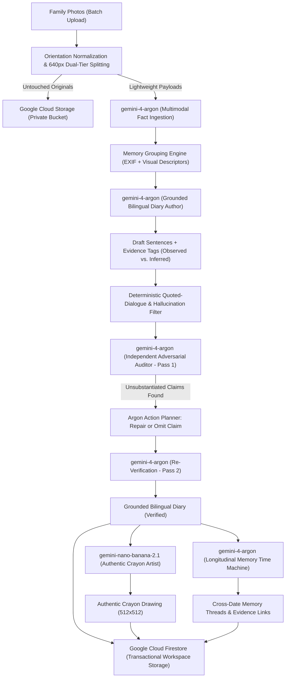

# My Little Picasso 🎨📒
### *Memories, Drawn from Life.*

> **"Cuteness comes from a child's crayon drawing; emotion comes from the passage of time."**  
> *Never invent false drama to manufacture emotion. Ground every memory in real family photographs, verifiable visual evidence, and authentic time.*

[](https://my-little-picasso-501770174905.asia-northeast3.run.app)
[](https://ai.google.dev/)
[](https://ai.google.dev/)
[](https://cloud.google.com/storage)
[](#-dual-cultural-journal-formats)

---

## 🌐 Live Production Deployment

- **Live Application URL:** [https://my-little-picasso-501770174905.asia-northeast3.run.app](https://my-little-picasso-501770174905.asia-northeast3.run.app)
- **Live Automated Health Check API:** [https://my-little-picasso-501770174905.asia-northeast3.run.app/api/health](https://my-little-picasso-501770174905.asia-northeast3.run.app/api/health)
- **Primary Region:** Google Cloud `asia-northeast3` (Seoul)

---

## 💡 Executive Summary

**My Little Picasso** is not an artistic image filter or a generic LLM wrapper. It is an **autonomous multimodal AI memory agent** that transforms batches of real family photos into authentic, grounded illustrated diaries, while discovering longitudinal **Memory Threads** across time.

Instead of hallucinating fictitious dialogue, emotional states, or dramatic narratives, My Little Picasso strictly adheres to **visual fact extraction, 1:1 photo evidence grounding, and a closed-loop 2-Pass Verification and Self-Repair agent architecture**.

---

## 🏆 Hackathon Evaluation Criteria & Architectural Alignment

| Evaluation Dimension | Architectural Implementation in My Little Picasso | Evidence in Codebase |
| :--- | :--- | :--- |
| **1. Substantive Use of Gemini 4 Argon** | **Gemini 4 Argon** orchestrates the entire reasoning pipeline: multimodal visual feature extraction, EXIF/visual memory clustering, factual diary authoring, independent adversarial auditing, and cross-diary temporal thread discovery via Google GenAI Interactions API. | [`src/lib/gemini.ts`](src/lib/gemini.ts)<br>[`PRIMARY_MODEL = "gemini-4-argon"`](src/lib/gemini.ts#L18) |
| **2. True Autonomous Agentic Behavior** | Autonomous cycle: **Inspect Visuals ➔ Form Hypotheses ➔ Group Memories ➔ Draft Grounded Content ➔ Execute Adversarial Audit ➔ Plan Self-Repair Actions (Repair vs. Omit) ➔ Re-Verify ➔ Trigger Multi-Artist Illustration**. It does not follow a brittle fixed script. | [`runRealVerificationAndRepairLoop()`](src/lib/gemini.ts)<br>[`src/app/api/studio/generate/route.ts`](src/app/api/studio/generate/route.ts) |
| **3. Real 2-Pass Verification & Repair Loop** | Employs an independent model auditor that verifies each sentence against visual evidence. Unsubstantiated claims are flagged (`REPAIRED` or `OMITTED`), triggering an actual second verification pass before final commit. Includes live **Hallucination Injection Stress Testing** in the UI. | [`src/lib/gemini.ts`](src/lib/gemini.ts#L700-L1000)<br>[`POST /api/verify-model`](src/app/api/verify-model/route.ts) |
| **4. Deep Multimodal Reasoning (Not Captioning)** | Discovers shared visual descriptors (e.g., yellow training bicycle, red sneakers, specific park benches) across disparate dates (2025 vs. 2026) to construct **Memory Threads** with explicit confidence levels and documented limits of inference. | [`discoverMemoryThreadsAcrossDiaries()`](src/lib/gemini.ts)<br>[`src/types/diary.ts`](src/types/diary.ts) |
| **5. Latency & Throughput Engineering** | Dual-tier image pipeline: original high-resolution photos are streamed directly to Cloud Storage untouched, while preprocessed, orientation-normalized 640px lightweight copies are fed to Gemini vision in parallel batches with streaming NDJSON events. | [`src/app/api/studio/generate/route.ts`](src/app/api/studio/generate/route.ts)<br>[`src/lib/storage.ts`](src/lib/storage.ts) |
| **6. Enterprise Privacy & Ephemeral Workspaces** | Zero-login privacy model. Browser generates a cryptographically random UUID v4 `workspaceId` and secret token. All storage and Firestore operations enforce `timingSafeEqual(SHA-256(token))` verification. Instant workspace wipe complies with 0s GCS soft-delete policy. | [`src/lib/storage.ts`](src/lib/storage.ts)<br>[`scripts/verify-cloud-persistence.mjs`](scripts/verify-cloud-persistence.mjs) |

---

## 🤖 AI Model Roles & Responsibilities

My Little Picasso separates orchestration, semantic reasoning, adversarial verification, and artistic rendering into specialized, best-in-class models:



### Detailed Model Delegation Matrix

| Model Identifier | Primary Responsibility | Why This Model? |
| :--- | :--- | :--- |
| **`gemini-4-argon`** | **Visual Fact Ingestion & Descriptors** | High-precision visual entity recognition without hallucinating speculative backstories or false actions. |
| **`gemini-4-argon`** | **Bilingual Grounded Diary Writing** | Crafts warm, child-perspective 3-sentence diaries in Korean and English, strictly referencing observed photo IDs. |
| **`gemini-4-argon`** | **Independent Auditor (2-Pass Verification Loop)** | Acts as an adversarial checker evaluating whether each sentence has definitive photographic backing. |
| **`gemini-4-argon`** | **Memory Threads / Time Machine Analysis** | Compares entities across months/years to detect genuine growth and recurring objects. |
| **`gemini-nano-banana-2.1`** | **Authentic Crayon Illustration** | Specialized diffusion model generating warm, child-like wax crayon textures, paper grain, and imperfect lines from grounded scene descriptions. |

---

## 🌟 Key Product Capabilities

### 1. 2-Pass Verification and Self-Repair Loop with Live Stress Testing
- Every sentence is labeled as either **Direct Observation (`observed`)** or **Contextual Inference (`context_inferred`)**.
- The independent **`gemini-4-argon` Auditor** analyzes each claim against the source photo evidence.
- If a sentence asserts fabricated quotes or unverifiable claims (e.g., *"Daddy promised we would go to Disneyland tomorrow"* when only a park bench is visible), the agent either repairs the text using strictly visible details or completely removes the sentence.
- **Live Demo Verification Feature:** Users can toggle **"🧪 Inject Fabricated Sentences"** directly in the studio UI to witness the agent catch, reject, and repair non-grounded claims in real time.

### 2. Dual Cultural Journal Formats (Instant Bilingual Toggle)
- **🇰🇷 Korean Elementary Squared Manuscript Grid (`원고지`):**
  - Compact **22-column** format (`MANUSCRIPT_COLS = 22`) fitting comfortably on a single screen without vertical bloat.
  - Authentic procedural handwriting micro-jitter applied to character positions.
- **🇺🇸 US Elementary Primary Writing Lines:**
  - 3-line ruled notebook layout (Top Headline, Midline Dash, Baseline) standard in American primary schools.
  - Clicking any sentence instantly highlights the exact source photograph associated with that sentence.
  - Toggling between Korean and English translates titles, dates, diary sentences, evidence notes, and calendar stamps in real time.

### 3. Monthly Illustrated Crayon Calendar (`월간 그림 달력`)
- Spiral-bound nostalgic calendar view (`Mon` – `Sun`, 1st to 31st).
- Empty leading days are decorated with crayon block lettering spelling the month name (e.g., `M · A · Y`).
- Every date with a recorded diary displays that day's **cute square crayon illustration, weather badge, date numeral, and hand-lettered memory stamp** (e.g., *"First Bicycle Ride"* / *"자전거 첫 연습"*).
- Clicking any day cell smoothly opens that specific daily diary page.

### 4. Weekly Representative Art Studio (`한 주를 대표하는 그림`)
- Aggregates all daily picture diaries within a given calendar week.
- Synthesizes a representative weekly crayon illustration and a unified reflection narrative, preserving the arc of family life over the week.

### 5. Fixed-Height Photo Filmstrip (Zero Vertical Layout Jitter)
- Handles 1 to 20+ photos per day without stretching the diary canvas vertically.
- Employs a **Featured Photo Frame (`aspect-4/3`) with Next/Previous arrows** combined with a horizontal thumbnail filmstrip.

### 6. Memory Time Machine (Cross-Date Memory Threads)
- Connects recurring objects, outfits, and developmental milestones across different months or years (e.g., *"Yellow balance bike with training wheels in May 2025"* ➔ *"Yellow pedal bike without training wheels in April 2026"*).
- Always details visual matching clues, confidence levels, and explicit inference limitations.

---

## 🔒 Enterprise-Grade Privacy & Ephemeral Workspaces

Family memories demand uncompromising privacy:
1. **Zero Login / Zero Tracking:** Workspaces are generated locally with cryptographically secure UUID v4 identifiers and private bearer tokens stored exclusively in `localStorage`.
2. **Timing-Safe Token Authentication:** Every API request to `/api/workspace`, `/api/workspace/media`, and `/api/studio/generate` performs `timingSafeEqual(SHA-256(requestToken), storedHash)`. Unauthorized access is rejected with `403 Forbidden`.
3. **Atomic Generation Epochs:** Generation jobs verify the workspace `generationEpoch`. If a user clicks **"Reset Workspace"** while an AI generation is in flight, the epoch counter atomically increments, automatically aborting and discarding stale cloud writes.
4. **Instant Destruction & Soft-Delete Compliance:** Resetting a workspace immediately purges all Firestore documents and invokes Google Cloud Storage bucket object deletions with retention set to `0 seconds`.

---

## 🚀 Getting Started & Local Development

### 1. Prerequisites
- Node.js 18+ (tested on Node.js 20 LTS & 22)
- Google Cloud Project with Cloud Run, Firestore, and Cloud Storage enabled
- Gemini API Key with access to `gemini-4-argon` and `gemini-nano-banana-2.1`

### 2. Environment Configuration
Create a `.env` file in the root directory (never commit API keys or credentials):
```env
GEMINI_API_KEY=your_gemini_api_key
GOOGLE_CLOUD_PROJECT=h2gdm-hack26icn-2627
GOOGLE_CLOUD_LOCATION=asia-northeast3
FIRESTORE_DATABASE_ID=(default)
GCS_MEDIA_BUCKET=h2gdm-hack26icn-2627-picasso-media
```

### 3. Installation & Local Execution
```bash
# Install dependencies
npm install

# Run Next.js local development server
npm run dev

# Open http://localhost:3000 in your browser
```

### 4. Automated Cloud Persistence & Verification Suite
Run the automated end-to-end cloud isolation test suite (13 critical assertions):
```bash
node scripts/verify-cloud-persistence.mjs
```

### 5. Production Cloud Run Deployment
Deploy directly to Google Cloud Run in `asia-northeast3`:
```bash
gcloud run deploy my-little-picasso \
  --source . \
  --region asia-northeast3 \
  --allow-unauthenticated
```

---

## 📂 Repository Structure

```text
├── src/
│   ├── app/
│   │   ├── api/
│   │   │   ├── health/route.ts            # Live API & Cloud dependency health check
│   │   │   ├── hello-diary/route.ts       # Single-photo hello world pipeline
│   │   │   ├── studio/generate/route.ts   # Multi-photo streaming NDJSON generation pipeline
│   │   │   ├── verify-model/route.ts      # Live Gemini 4 Argon interactive audit endpoint
│   │   │   ├── workspace/route.ts         # Workspace CRUD, bilingual translation & weekly summaries
│   │   │   └── workspace/media/route.ts   # Authenticated media serving from GCS
│   │   ├── globals.css                    # Warm paper textures, crayon styles, manuscript grids
│   │   ├── layout.tsx                     # Root layout with warm typography
│   │   └── page.tsx                       # Full-featured bilingual interactive client studio
│   ├── lib/
│   │   ├── demo-photos.ts                 # 5 curated multi-date demo photos for instant exploration
│   │   ├── gemini.ts                      # Gemini 4 Argon & Nano Banana 2.1 orchestration & verification
│   │   └── storage.ts                     # Firestore & GCS secure multi-tenant storage manager
│   └── types/
│       └── diary.ts                       # Strong TypeScript definitions for Grounding, Audits, Threads
├── scripts/
│   ├── verify-cloud-persistence.mjs       # Automated 13-point cloud isolation verification
│   └── test-agent-pipeline.mjs            # Autonomous pipeline unit test
├── Dockerfile                             # Optimized container build for Google Cloud Run
├── README.md                              # Comprehensive Hackathon submission documentation
└── package.json                           # Dependencies & build scripts
```

---

## 🏆 Hackathon Team & Acknowledgements

Created with ❤️ for the **Google DeepMind Hackathon 2026** by the **My Little Picasso** Team.  
*Memories, Drawn from Life.*
